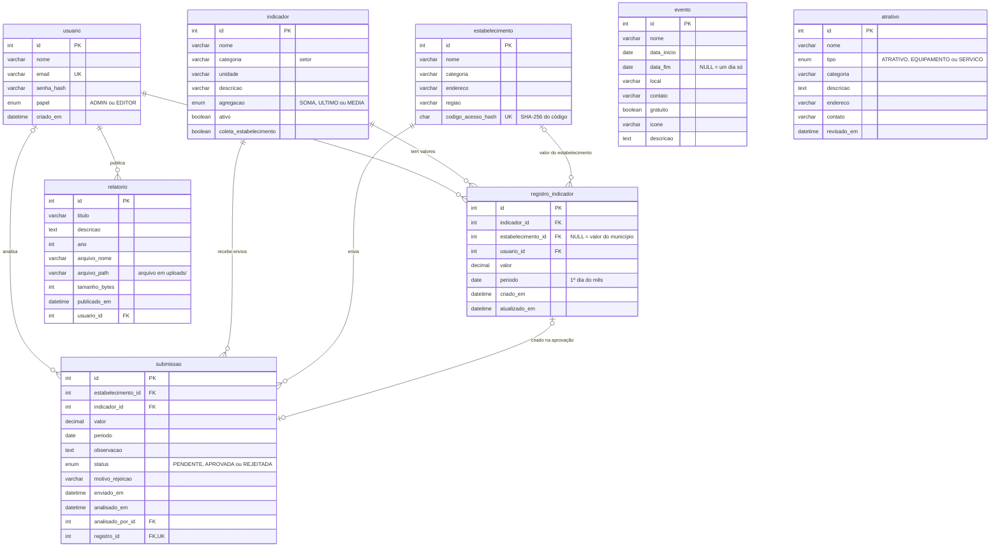

# Banco de dados — Observatório do Turismo

Banco **MySQL 8**, acessado pela API com o **Prisma 7**. A estrutura completa fica em
`backend/prisma/schema.prisma` e cada mudança tem uma migration em `backend/prisma/migrations/`.

O modelo do Milestone III tinha 4 tabelas (`usuario`, `indicador`, `registro_indicador` e
`relatorio`). Na implementação, `estabelecimento` entrou já na primeira migration, e depois vieram
`evento`, `atrativo` (inventário turístico) e `submissao` (coleta pelos hotéis): 8 tabelas no total.

## Diagrama

O GitHub desenha o diagrama abaixo automaticamente.

## Tabelas

| Tabela | Guarda | Observações |
|---|---|---|
| `usuario` | Equipe da SMCELT com acesso ao painel | Senha guardada com bcrypt. Papel `ADMIN` pode excluir e gerenciar usuários; `EDITOR` não |
| `indicador` | O que é medido (Visitantes, Taxa de ocupação, Leitos…) | `categoria` é o setor usado nos filtros. `agregacao` diz como somar vários meses: SOMA (visitantes), MEDIA (taxas) ou ULTIMO (estoques, como nº de leitos). `coleta_estabelecimento` libera o indicador para os hotéis enviarem |
| `registro_indicador` | O valor oficial de um indicador em um mês | Sem `estabelecimento_id` = valor do município, que tem prioridade no dashboard. Não pode haver dois valores para o mesmo indicador, mês e estabelecimento |
| `relatorio` | Relatórios publicados | O PDF fica na pasta `backend/uploads/`; o banco guarda o nome e o tamanho |
| `estabelecimento` | Hotéis, pousadas e outros negócios | Guarda só o **hash** do código de acesso da coleta, nunca o código. Não pode ser apagado se tiver valores publicados |
| `submissao` | Envios feitos pelos estabelecimentos | Entra como `PENDENTE`. Ao ser aprovado, cria o `registro_indicador` (na mesma transação) e guarda o `registro_id`. Rejeitado guarda o motivo |
| `evento` | Eventos turísticos da cidade | Exibidos na Home e no dashboard |
| `atrativo` | Inventário turístico (atrativos, equipamentos, serviços) | `revisado_em` muda a cada edição ou revisão; itens com mais de 12 meses aparecem no lembrete do painel |

## Migrations

| Migration | O que fez |
|---|---|
| `20261002203838_init` | Tabelas do Milestone III: usuario, indicador, estabelecimento, registro_indicador, relatorio |
| `20261006210537_eventos` | Tabela evento |
| `20261007013423_inventario` | Tabela atrativo |
| `20261014130023_coleta_estabelecimentos` | Tabela submissao, código de acesso dos estabelecimentos e `coleta_estabelecimento` nos indicadores |
